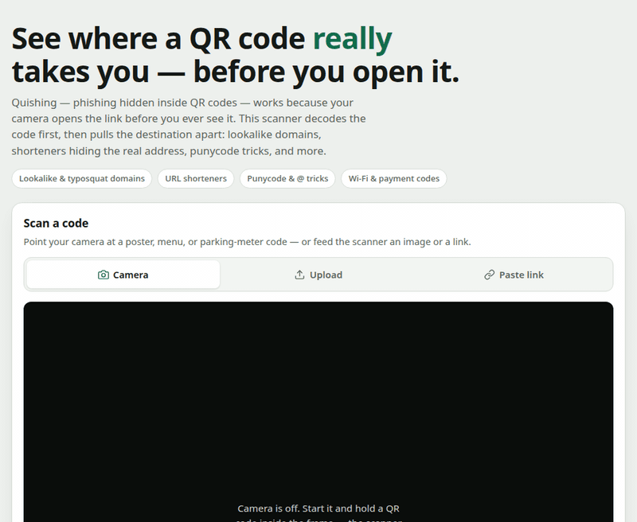

# QR Phishing Scanner



**Live site:** https://adityaaravind.github.io/qr-phishing-scanner/ — works on phones too (camera needs HTTPS, which the live site has).

Scan a QR code first, check where it goes before opening it. Your phone camera opens the link in a QR code without showing you the destination, and that is exactly what quishing relies on — a sticker over a real code on a parking meter, a restaurant table, or an EV charger.

This page decodes the code in your browser and scores the destination, so you can see the real domain before you tap anything.

## What it checks

- Lookalike and typosquat domains (26 brands — PayPal, Apple, Microsoft, Google, Amazon, banks, and others)
- Subdomain tricks, where the brand name is just a subdomain and the real domain is something else
- URL shorteners that hide the destination
- Punycode domains (xn--...)
- The @ trick, where the address before the @ is ignored
- Raw IP addresses and unencrypted HTTP links
- High-abuse domain endings
- Redirect parameters and urgency words in the link
- Non-link codes too: Wi-Fi auto-join, payment addresses, authenticator setup codes, contact cards, and call/text codes

## How to use

Open the page, then pick Camera, Upload, or Paste link. Point the camera at a code, drop in a screenshot, or paste a link to check it. There are practice codes on the page if you want to try it first.

The camera needs localhost or HTTPS, so it works from a local server or a hosted page, not from a plain file open.

## How to run locally

```
python3 -m http.server
```

Then open http://localhost:8000 in your browser.

### Run the tests

```
node tests/analyze.test.js
```

The tests load the analysis engine from `assets/js/app.js` and check known phishing patterns, known false positives, and Wi-Fi and host:port parsing. Requires Node 18+.

## How it works and limits

Everything runs offline in your browser (the QR libraries are bundled, not loaded from a CDN) as heuristics on the structure of the decoded content. No data leaves your device, and camera frames are never uploaded.

There is no live threat-intelligence lookup, so a low score means nothing suspicious was found, not that the link is safe. Do not follow a QR code for money or passwords — go to the site yourself instead.

## Project structure

- index.html — page markup
- assets/css/styles.css — styles
- assets/js/app.js — QR decoding and the risk checks
- assets/vendor/ — jsQR 1.4.0 and qrcode-generator 1.4.4, bundled so the page works offline
- tests/analyze.test.js — regression tests for the risk checks
- docs/demo.gif — demo recording used at the top of this README
- LICENSE — MIT
